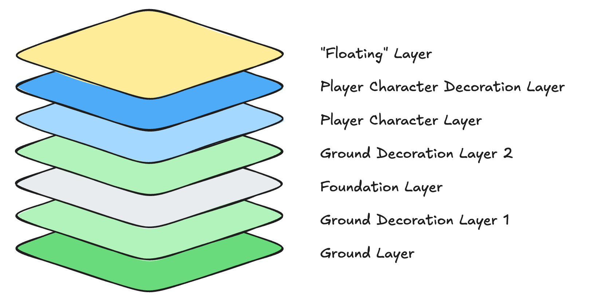

# Engine

The "engine is the main driving point of the game. It controls the logic for how the game operates,
as well as necessary information for rendering, sound effects, and music.

## Rendering

The rendering of the game is done in layers of tiles, with the bottom layers being drawn first. Each
layer contains a set of tiles, each of which is 64px x 64px. Tile textures may not be exactly 64px.
This means that rendering to an area that is larger requires transparency in order to perform
proper compositing. Rendering to an area that is smaller than the texture size requires that the
source texture be downsampled appropriately. `macroquad` takes care of this for us.

### Layers

The stack of layers can be thought of like the following diagram:

